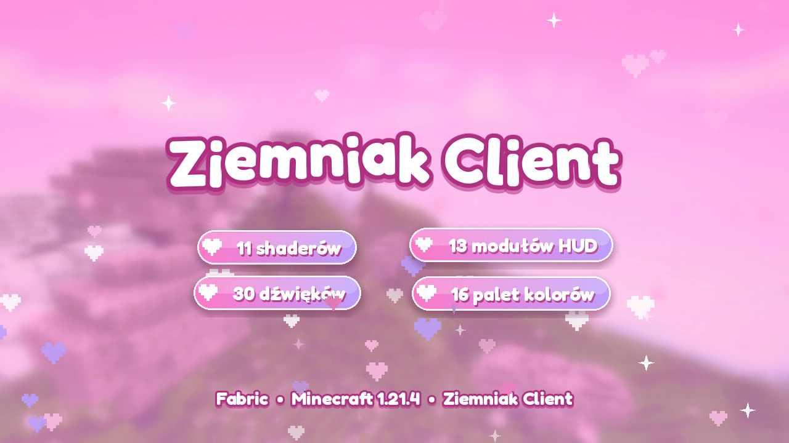
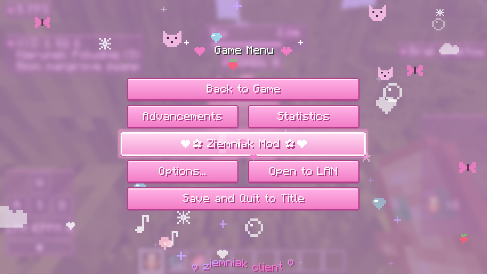
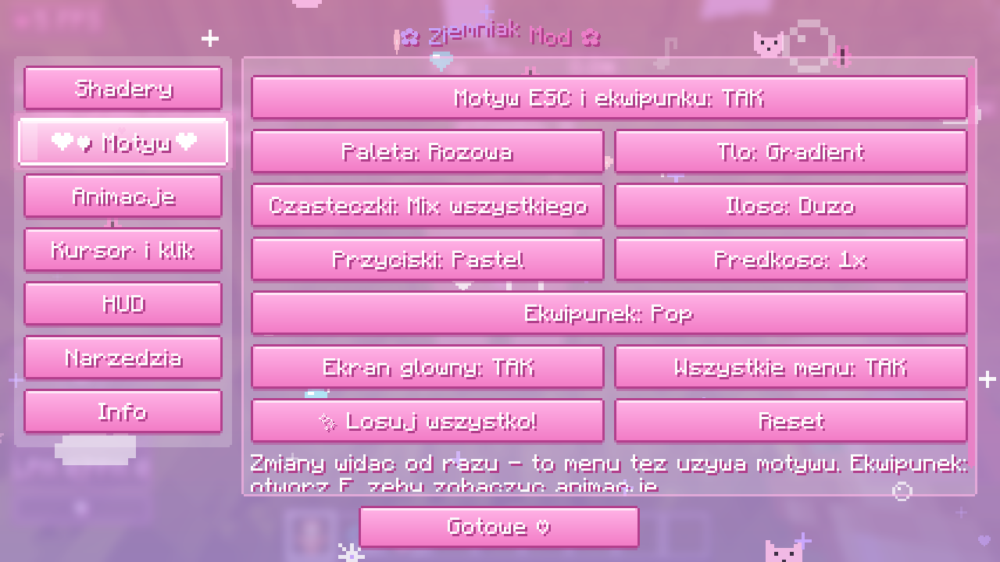
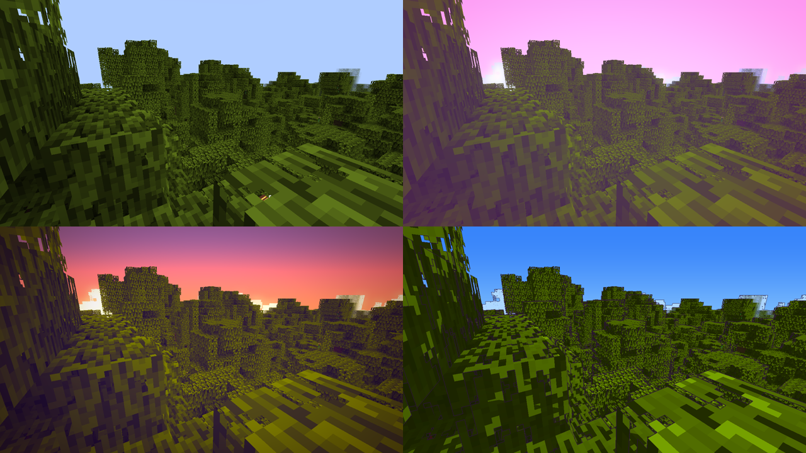
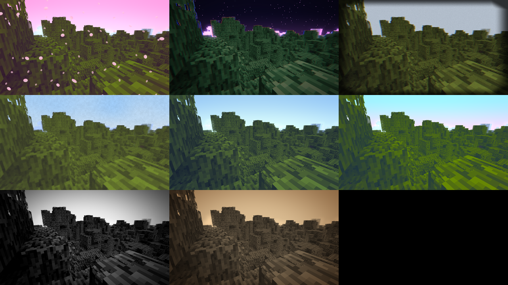
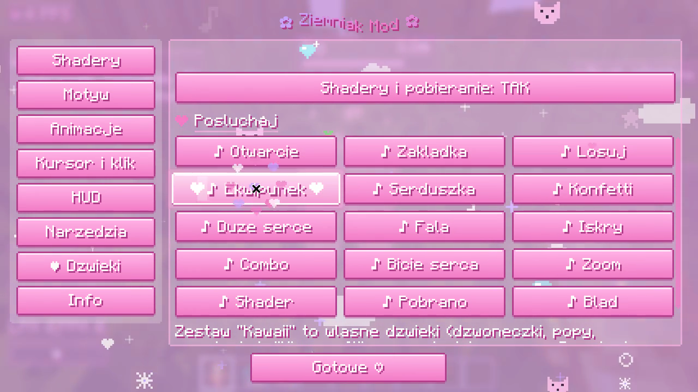
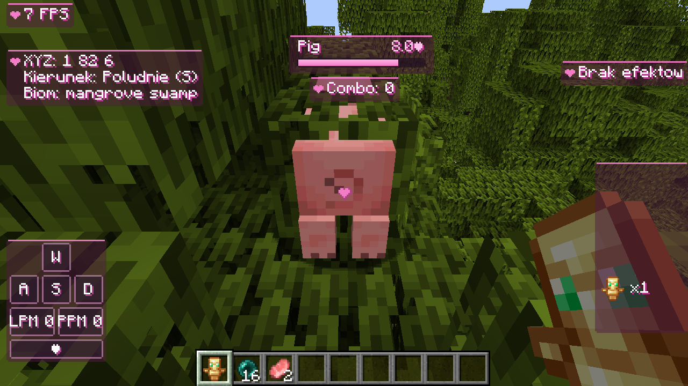
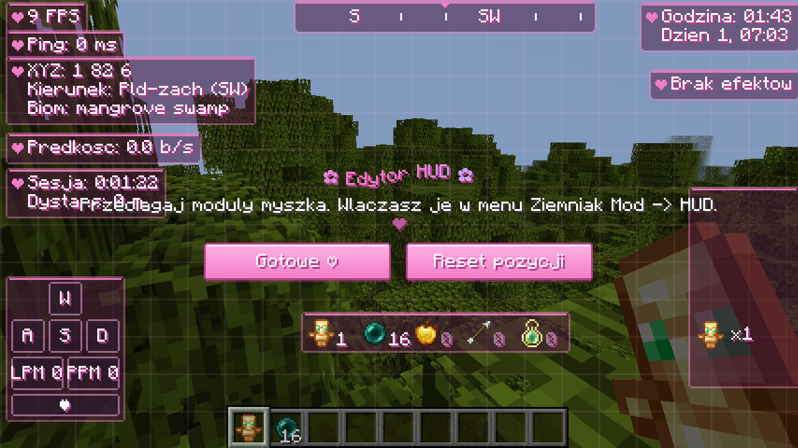
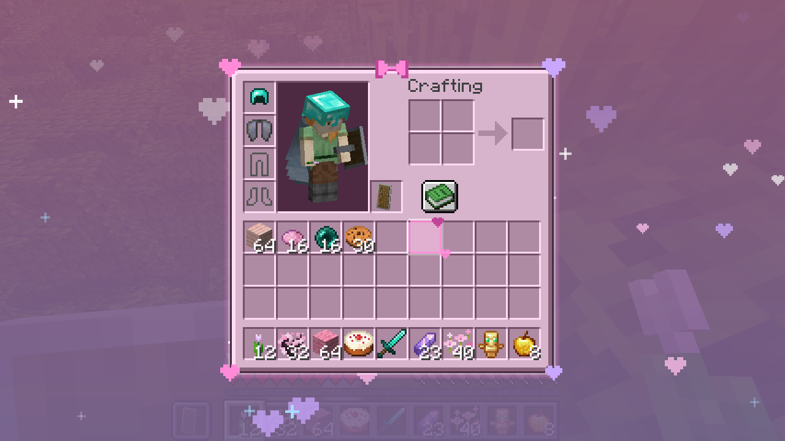

# Ziemniak Client (Fabric 1.21.4)

Pastelowy (femboy) mod client-side: motyw menu i ekwipunku z animacjami, wlasne shadery,
pobieranie shaderow z internetu, HUD z edytorem, zoom, fullbright, wlasne celowniki.

- Menu moda: przycisk **"Ziemniak Mod"** w menu ESC albo klawisz **Prawy Shift**.
- Zoom: trzymaj **C** (kolko myszy = mocniej/slabiej).
- Wszystko zapisuje sie w `.minecraft/config/ziemniak-client.json`.

**Film promocyjny (25 s, z muzyka):** `podglad/ziemniak-client-promo.mp4`

Filmiki (po 1 s): `podglad/menu-esc.mp4`, `podglad/ziemniak-mod-menu.mp4`,
`podglad/shader-sny-sakury.mp4`, `podglad/ekwipunek.mp4`.

## Zakladki menu moda

**Shadery**
- 11 wlasnych shaderow (dzialaja od razu, bez Iris, lekkie dla komputera):
  Rozowy Sen, Zlota Godzina, Anime, Sny Sakury (spadajace platki), Neon Noc (gwiazdy),
  Retro VHS, Akwarela, Zimowy Poranek, Cukierkowy, Noir, Stara Fotografia.
- 10 shaderow z internetu (Modrinth) do pobrania jednym kliknieciem, podzielonych na
  Lekkie / Srednie / Mocne: MakeUp Ultra Fast, Vanilla Plus, Super Duper Vanilla, BSL,
  Complementary Reimagined, Complementary Unbound, Solas, Bliss, Photon, Sildur's Vibrant.
- Przycisk "Pobierz Iris + Sodium" (shadery z netu potrzebuja Iris), potem "Wlacz" przy paczce.
- "Twoj komputer": nazwa karty graficznej, FPS i polecana grupa shaderow.

**Motyw**: 16 palet, 7 rodzajow tla (gradient, zorza, tecza, gwiazdy, kratka, fale, bokeh),
12 rodzajow czasteczek + mix (serduszka, gwiazdki, sakura, babelki, motylki, snieg, nutki,
kocie lapki, chmurki, truskawki, diamenty, kotki), 4 style przyciskow, 4 predkosci animacji,
4 animacje otwierania ekwipunku, motyw na ekranie glownym i we wszystkich menu (tez suwaki),
"Losuj wszystko!" i "Reset".

**Animacje**: 14 przelacznikow (czasteczki, iskierki, spadajace gwiazdy, wjazd przyciskow,
poswiata, blysk, serduszka przy napisie, podskok, serca przy tytule, falujacy napis,
poswiata panelu, kokardka, serca w rogach, ramka slotu).

**Kursor i klik**: 7 efektow klikniecia, 5 sladow kursora, serduszko przy kursorze.

**HUD**: 13 modulow (FPS, ping, koordynaty+kierunek+biom, zegar, predkosc, sesja, efekty mikstur,
klawisze + CPS, zbroja z wytrzymaloscia, licznik przedmiotow, cel z paskiem HP, combo, kompas),
edytor przeciagania myszka, skala HUD, tlo modulow, ostrzezenie przy niskim HP.

**Dzwieki**: 30 wlasnych dzwiekow (dzwoneczki, popy, iskierki, "boing", konfetti, bicie serca, zoom, magia shaderow)
+ pozytywka grajaca w menu ESC, menu moda i na ekranie glownym. Graja przy: najechaniu i kliknieciu przycisku,
przelacznikach TAK/NIE, zmianie zakladki, otwarciu/zamknieciu menu i ekwipunku, najechaniu na slot z przedmiotem,
efektach klikniecia (kazdy efekt ma swoj dzwiek), combo (coraz wyzszy ton), niskim HP (bicie serca), zoomie,
wlaczeniu/wylaczeniu shadera, pobieraniu (start, gotowe, blad), losowaniu i resecie, przeciaganiu w edytorze HUD.
Dwa zestawy: "Kawaii" (wlasne) i "Minecraft" (dzwieki z gry), 4 poziomy glosnosci, 5 kategorii do wylaczenia,
przyciski "Posluchaj" do testu. Film z dzwiekiem: `podglad/dzwieki-demo.mp4`.
Dzwieki generuje skrypt `tools/sounds/generate.py` (python3 + numpy + ffmpeg).

**Narzedzia**: zoom (2x/4x/6x/10x, plynna kamera), fullbright, 6 wlasnych celownikow,
sprint/skradanie na przelacznik (opcje Minecrafta).

## Femboy motyw (menu ESC + ekwipunek)

**Menu ESC**
- tlo, czasteczki i iskierki wedlug ustawien motywu
- przyciski wjezdzaja na zmiane z lewej i prawej z odbiciem
- zaokraglone przyciski: po najechaniu powiekszaja sie, swieca, przelatuje po nich blask, a obok napisu wskakuja serduszka
- pulsujace serduszka przy tytule, falujacy napis "ziemniak client" na dole
- przycisk "Ziemniak Mod" w miejscu "Give Feedback" i "Report Bugs"

**Ekwipunek (i kazdy inny ekran ze slotami: skrzynia, piec itd.)**
- animacja otwarcia (pop / wjazd z dolu / obrot / sprezyna)
- odcien panelu, pulsujaca poswiata wokol, kokardka na gorze, serduszka w rogach
- slot pod myszka: pulsujaca ramka i skaczace serduszko

Kod: `src/main/java/com/ziemniak/client/` (`theme/`, `shader/`, `hud/`, `screen/`, `mixin/`),
shadery w `src/main/resources/assets/ziemniak/`.

## Jak zbudowac (potrzebujesz internetu)
1. Zainstaluj **JDK 21**.
2. Wypakuj ten folder, wejdz w niego w terminalu.
3. `./gradlew build` (Windows: `gradlew.bat build`) - Gradle sam sciagnie
   Minecraft 1.21.4, mapping i Fabric API z internetu przy pierwszym buildzie.
4. Gotowy jar bedzie w `build/libs/ziemniak-client-1.0.0.jar`.
5. Wrzuc go do folderu `.minecraft/mods` (wymaga zainstalowanego Fabric Loadera dla 1.21.4).

Uwaga: sprawdz w `gradle.properties`, czy `fabric_version` odpowiada
najnowszej wersji Fabric API pod 1.21.4 (lista: modrinth.com/mod/fabric-api/versions),
bo numerki wersji zmieniaja sie co jakis czas.

## Czego CELOWO nie ma (i dlaczego)
- **Logowanie/zapisywanie kont, wybor wersji MC** - to robi launcher
  (oficjalny Minecraft Launcher albo Prism/MultiMC), nie mod. Mod dziala
  na tej wersji, na ktora go zbudowales (tu: 1.21.4) - jeden jar = jedna wersja.
  Zeby "przelaczac wersje" jak w launcherach, musialbys zbudowac osobny
  launcher od zera (autoryzacja Microsoft OAuth, pobieranie assetow itd.)
  - to osobny, wielotygodniowy projekt, nie mod.
- **Instalowanie modow z poziomu clienta (jak w Feather/Modrinth App)** -
  to tez osobna aplikacja (menedzer modow), nie cos co mod moze zrobic
  sam sobie. Do tego polecam po prostu **Modrinth App** albo **Prism Launcher**
  - oba juz to robia i obsluguja Fabric 1.21.4 od reki.
- **Killaura / reach / velocity / autoclicker** - swiadomie pominiete,
  bo to czity dajace nieuczciwa przewage i w 99% przypadkow lamie
  regulamin serwera (ryzyko bana). Zamiast tego dodalem legalny PvP-feedback
  (hit indicator, combo, HP HUD).

## Rozwoj
- Nowy modul HUD: dopisz `MODULES.add(...)` w `hud/HudManager.java` - sam pojawi sie w zakladce HUD i w edytorze.
- Nowy wlasny shader: plik `post_effect/<nazwa>.json` (+ ewentualnie program w `shaders/post/`)
  i jedna linijka w `ShaderManager.OWN`.
- Nowa opcja: pole w `ZiemniakConfig` + przycisk w `ZiemniakMenuScreen`.
